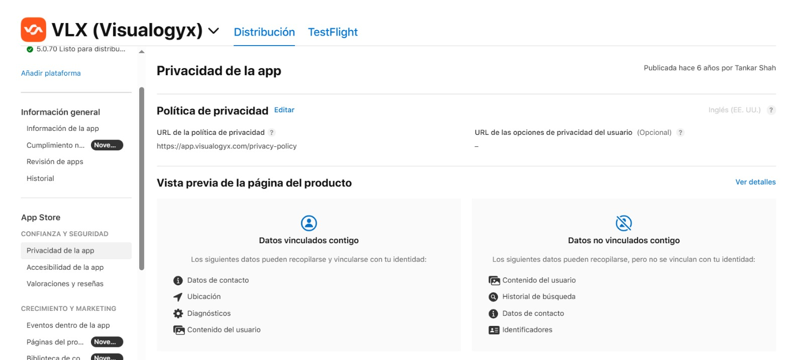
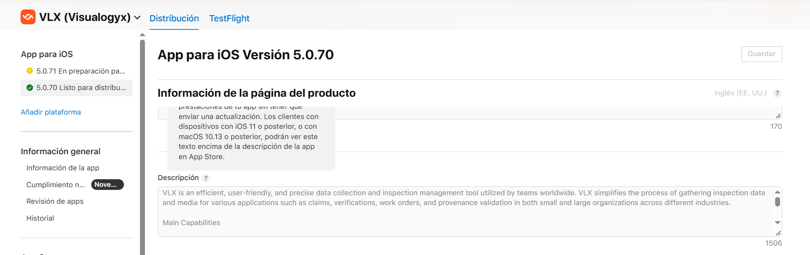
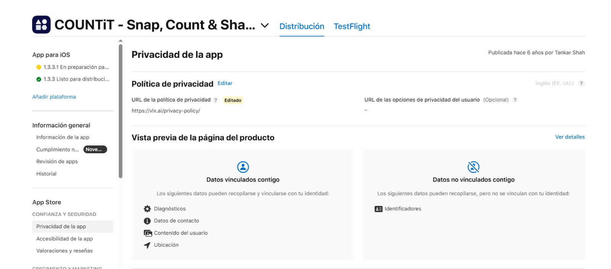
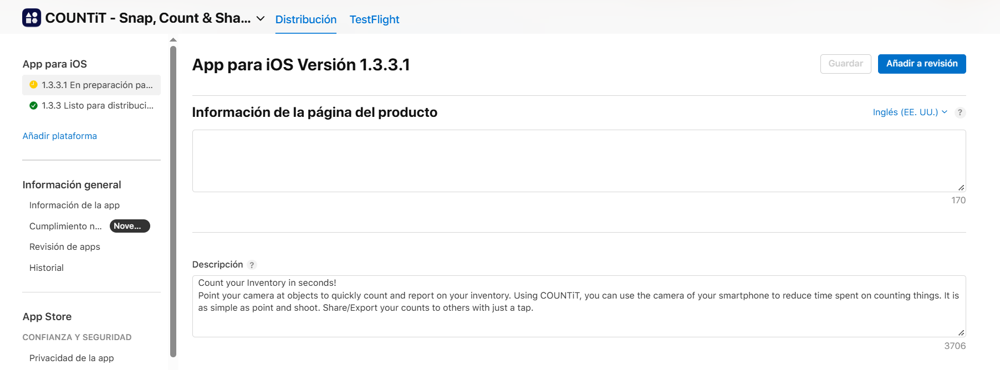

# VLX and COUNTiT on the App Store and Google Play: URLs to update and optimized listing copy (ASO)

_November 20, 2026. Based on the public US listings in both stores; every URL was checked live._

**Status:** the App Store step-by-step (sections 1.1 and 1.2) is ready. The Google Play step-by-step is **pending**; the proposed Google Play copy is in sections 5 and 6.

**Contents**

1. [What to change in the App Store (with screenshots)](#1-what-to-change-in-the-app-store)
2. [How a store listing is optimized (rules for each store)](#2-how-a-store-listing-is-optimized)
3. [Chosen keywords and why](#3-chosen-keywords)
4. [Ready-to-paste App Store copy](#4-app-store-copy)
5. [Ready-to-paste Google Play copy](#5-google-play-copy)
6. [Full descriptions (both stores)](#6-full-descriptions)

---

## 1. What to change in the App Store

URL mapping:

| Current URL | New URL |
|---|---|
| `https://www.visualogyx.com/how-it-works-business/` | `https://vlx.ai/digital-inspections-software/` |
| `https://www.visualogyx.com/business/` | `https://vlx.ai/product/` |
| `https://app.visualogyx.com/privacy-policy` | `https://app.vlx.ai/privacy-policy` |

Checked today: all three new URLs return **200**. `www.visualogyx.com` **no longer responds**, so any listing that still uses it has broken links.

### 1.1 VLX (Visualogyx), iOS

Two things to do in VLX: **(A)** change the privacy policy link and **(B)** add the optimized description.

#### Step A: change the privacy policy link



**Where:** *App Store → Trust and Safety → App Privacy → Privacy Policy → **Edit***.

| Field | Current link (remove) | **New link (add)** |
|---|---|---|
| Privacy Policy URL | `https://app.visualogyx.com/privacy-policy` | **`https://app.vlx.ai/privacy-policy`** |

- The new link works (returns 200).
- "User Privacy Choices URL" is optional and stays empty.
- This change is saved right away; it doesn't need a new version submitted for review.
- VLX's developer website (`https://www.vlx.ai`) and support URL (`https://www.vlx.ai/support`) already point to vlx.ai and work, so they don't need changes.

#### Step B: add the optimized description



**Where:** in the left column, *iOS App → **5.0.71 Prepare for Submission***. Then, under *Product Page Information*:

| Field | What to enter | Limit |
|---|---|---|
| **Description** | Delete the current text ("VLX is an efficient, user-friendly… Main Capabilities…", 1,506 characters) and paste the **description from section [6.1](#61-vlx)** | 4,000 |
| **Promotional Text** (the field above, with the 170 counter) | `Build inspection checklists, capture photo evidence offline and send branded PDF reports from the field. Built for quality, safety, property and asset audits.` | 170 |
| **Keywords** (further down on the same page) | `visualogyx,form,template,photo,offline,pdf,quality,safety,property,equipment,compliance,survey,qa` | 100 |

- This must be done in **5.0.71**, not in 5.0.70 (the version in the screenshot): 5.0.70 is already live and Apple doesn't allow changing its description. The new description goes live when Apple approves 5.0.71. Promotional text is the only field that can be changed on a live version.
- The new name and subtitle (section 4) are changed under *App Information* and also go live with 5.0.71.

### 1.2 COUNTiT – Snap, Count & Share, iOS

Two things to do in COUNTiT: **(A)** change the URLs and **(B)** replace the description with the optimized one.

#### Step A: change the URLs



**A.1 Privacy Policy URL.** In *App Store → Trust and Safety → App Privacy → Privacy Policy → **Edit***.

| Field | Current link (remove) | **New link (add)** |
|---|---|---|
| Privacy Policy URL | `https://vlx.ai/privacy-policy/` (marked "Edited", not yet live). The public listing still shows `https://www.visualogyx.com/privacy-policy`, which is down | **`https://app.vlx.ai/privacy-policy`** |

- It's the same link as VLX: both apps point to the app's privacy policy.
- "User Privacy Choices URL" is optional and stays empty.

**A.2 Marketing URL and Support URL.** In *iOS App → **1.3.3.1 Prepare for Submission***, on the same page as the screenshot below, scrolling down past *Description* and *Keywords*.

| Field | Current link (remove) | **New link (add)** |
|---|---|---|
| Marketing URL (shown in the store as "Developer Website") | `https://www.visualogyx.com/business/` | **`https://vlx.ai/product/`** |
| Support URL | `https://www.visualogyx.com/how-it-works-business/` | **`https://vlx.ai/digital-inspections-software/`** |

- All three new links return 200. The two old `www.visualogyx.com` links are down: today the listing has broken links.
- The Marketing and Support URLs go live when Apple approves 1.3.3.1.

#### Step B: replace the description with the optimized one



**Where:** *iOS App → **1.3.3.1 Prepare for Submission** → Product Page Information*.

| Field | What to enter | Limit |
|---|---|---|
| **Description** | Delete all the current text ("Count your Inventory in seconds! Point your camera at objects…", about 300 characters today) and paste the **description from section [6.2](#62-countit)** | 4,000 |
| **Promotional Text** (the empty field above, with the 170 counter) | `Snap a photo and let machine learning count pallets, pipes and items on a shelf in seconds. Keep photo proof of every count and share it with your team.` | 170 |
| **Keywords** (further down on the same page) | `counter,tally,stock,camera,picture,pallet,pipe,warehouse,stockpile,shelf,item,scan,ai,fleet,vlx` | 100 |

- When done: **Save**, then **Add for Review**. The description, keywords and the step A.2 URLs go live when Apple approves 1.3.3.1.
- The new name and subtitle (section 4) are changed under *App Information* and go live with this same version.

### 1.3 Google Play (no link changes; step-by-step pending)

The Google Play listings only need the copy optimization in sections 5 and 6. One thing to check: the **public** VLX listing on Google Play (`com.visualogyx.app`) still shows the privacy policy `https://www.visualogyx.com/privacy-policy`, and that domain no longer responds. If it was already changed in Play Console, it just needs to go live. If not, it should be changed to `https://app.vlx.ai/privacy-policy`: Google can remove an app whose privacy policy link is broken.

---

## 2. How a store listing is optimized

The two stores rank apps differently, which is why the copy in sections 4 and 5 isn't the same.

**App Store (Apple)**

| Field | Limit | Indexed for search? | How to use it |
|---|---|---|---|
| App name | 30 | Yes, the highest-weight field | Brand + main keyword |
| Subtitle | 30 | Yes | Secondary keywords not already in the name |
| Keyword field (hidden) | 100 bytes | Yes | Words separated by commas **with no spaces**. **Don't repeat** words from the name or subtitle (Apple gives no extra weight for repeats) or add plurals. **Don't use competitor names** (a rejection reason) |
| Promotional text | 170 | No | For conversion; can be changed without review |
| Description | 4,000 | **No** | Written to convince the reader, not to rank |

**Google Play**

| Field | Limit | Indexed for search? | How to use it |
|---|---|---|---|
| Title | 30 | Yes, the highest-weight field | Brand + main keyword. No emojis or ALL CAPS for emphasis |
| Short description | 80 | Yes, heavily | Main keyword + benefit |
| Full description | 4,000 | **Yes** (there is no keyword field) | Keywords spread naturally across the text. Excessive repetition is prohibited and can lead to suspension |

For both stores: no prices, promotions, or phrases like "#1" or "best" in the copy (metadata policies). Ratings matter too: COUNTiT has **2.0 ★ from only 4 reviews** on iOS, which hurts both conversion and ranking. Asking for reviews inside the app (SKStoreReviewController / In-App Review API) would help.

---

## 3. Chosen keywords

Source: Ranki, US Google searches (monthly volume / difficulty). Ranki has no in-store search data, so Google volume is used as an indicator of the terms people search to find an app.

**VLX (inspections)**

| Keyword | Vol. | KD | Where it goes |
|---|---|---|---|
| field inspection app | 480 | 0 | Name/title |
| inspection app / inspection checklist | (core term) | — | Name, subtitle, descriptions |
| property inspection app | 170 | 14 | iOS keywords, description |
| safety inspection app / safety checklist app | 70 / 70 | 6 / 7 | iOS keywords, description |
| equipment inspection app | 30 | 3 | iOS keywords, description |
| construction checklist app | 40 | 0 | Description |
| inspection reporting app | 20 | 9 | Subtitle ("Reports"), description |
| mobile / field audit app | 20 / 20 | 0 / 23 | Subtitle/title ("Audit") |
| visualogyx (former brand) | — | — | iOS keywords, so people searching the old brand still find the app |

**COUNTiT (photo counting)**

| Keyword | Vol. | KD | Where it goes |
|---|---|---|---|
| inventory count app | 40 | 0 | Name/title |
| counter tally count app | 70 | 19 | iOS keywords (counter, tally) |
| inventory scanning / scanner app | 170 / 170 | 4 / 3 | iOS keywords (scan), description |
| count objects in a picture app | 10 | 32 | Subtitle |
| stock count app (iPhone/Android) | 10 | — | iOS keywords (stock), short description |
| pallets, pipes, stockpiles, shelf | — | — | COUNTiT's real use cases according to vlx.ai |

Generic "checklist app" and "inventory app" (9,900 and 1,300 searches) were left out: people searching them want to-do lists or home inventory, and both have KD 69–74.

---

## 4. App Store copy

> Name, subtitle and keywords can only be changed **with a new version**. Add them to the version that's in preparation. Promotional text can be changed at any time.

### VLX (Visualogyx)

| Field | Copy | Chars |
|---|---|---|
| Name | `VLX: Field Inspection App` | 25/30 |
| Subtitle | `Checklists, Audits & Reports` | 28/30 |
| Keywords | `visualogyx,form,template,photo,offline,pdf,quality,safety,property,equipment,compliance,survey,qa` | 97/100 |
| Promotional text | `Build inspection checklists, capture photo evidence offline and send branded PDF reports from the field. Built for quality, safety, property and asset audits.` | 158/170 |

Before: name "VLX (Visualogyx)", subtitle "Inspections, Audits, Templates". The name had no keywords. "Visualogyx" moves to the keyword field, so people searching the old brand still find the app.

### COUNTiT

| Field | Copy | Chars |
|---|---|---|
| Name | `COUNTiT: Inventory Count App` | 28/30 |
| Subtitle | `Count Objects from a Photo` | 26/30 |
| Keywords | `counter,tally,stock,camera,picture,pallet,pipe,warehouse,stockpile,shelf,item,scan,ai,fleet,vlx` | 95/100 |
| Promotional text | `Snap a photo and let machine learning count pallets, pipes and items on a shelf in seconds. Keep photo proof of every count and share it with your team.` | 152/170 |

Before: name "COUNTiT - Snap, Count & Share" (a tagline with no keywords) and subtitle "Count Inventory in seconds!". "Snap, Count & Share" can stay in the screenshots and the description.

---

## 5. Google Play copy

### VLX (`com.visualogyx.app`)

| Field | Copy | Chars |
|---|---|---|
| Title | `VLX: Field Inspection & Audit` | 29/30 |
| Short description | `Inspection checklists, photo evidence & PDF reports. Works offline in the field.` | 80/80 |
| Full description | The one in section 6.1 | — |

Before: title "VLX (Visualogyx)" and short description "Inspections made easy for your processes, work orders, QA validations, and more."

### COUNTiT (`com.visualogyx.countit.app`)

| Field | Copy | Chars |
|---|---|---|
| Title | `COUNTiT: Inventory Count App` | 28/30 |
| Short description | `Snap a photo to count pallets, pipes and stock in seconds. Share counts fast.` | 77/80 |
| Full description | The one in section 6.2 | — |

Before: the full description was **3 sentences**. On Google Play it's the most heavily indexed text, so it's the change that will move COUNTiT the most.

---

## 6. Full descriptions

These work for both stores: on Google Play they help ranking, and on the App Store they help conversion. They only describe features already published in the current listing or on vlx.ai.

### 6.1 VLX

```text
VLX is a field inspection app for teams that need reliable data from the field. Build inspection checklists and custom forms, capture photo and video evidence, and send branded PDF inspection reports in minutes, online or offline.

Teams use VLX for quality control, safety inspections, property inspections, equipment checks, audits, claims, work orders and asset verification, in companies of any size and across industries.

Build checklists and forms your way
Create inspection templates with the built-in template designer. Add scoring, conditional logic, calculated fields and barcode fields, then reuse your templates across the team. Or start from a public template library shared by other VLX users and customize it.

Capture photo and video evidence
Collect text, photos, video and geolocation during every inspection, audit or survey, so each inspection has a clear audit trail.

Work offline, sync later
Run inspections in remote locations with no signal. VLX syncs every device to the cloud as soon as the connection is back.

Send instant PDF inspection reports
Generate a custom-branded PDF report with all form fields and images as soon as you finish the inspection, and share it with clients, vendors or regulators.

Organize teams and projects
Group related inspections under projects, assign users and roles with different access rights, and keep every team working from the same templates.

Collaborate with third parties
Invite external users to view and collaborate on your projects, and share reports outside your organization.

Who uses VLX
- Quality and compliance teams running QA inspections and audits
- Safety teams doing EHS audits and safety checklists
- Property and real estate teams doing property inspections
- Field service, construction, insurance, manufacturing, oil and gas, and logistics teams

Learn more at vlx.ai
```

Keywords covered: field inspection app, inspection checklists, inspection reports, audits, quality control, safety inspections, property inspections, equipment checks, offline, PDF report, templates. Each term appears 1 to 3 times: no stuffing.

### 6.2 COUNTiT

```text
COUNTiT is an inventory count app that counts objects from a photo. Point your camera, snap a picture and get a count in seconds. Snap, count and share.

Count anything, faster than by hand
COUNTiT uses machine learning to count pallets in a warehouse, pipes in a yard, items on a shelf, stockpiles and fleet units. No more clipboard tallies, recounts or typing errors.

Photo proof for every count
Each count is saved with its photo, so you can check the total later and avoid disputes about stock numbers.

Share and export counts with a tap
Send your counts to your team or export them as soon as you finish.

Built for inventory and stock counts
- Warehouse and stock counts
- Pipe yard and stockpile counts
- Shelf and retail inventory checks
- Fleet and equipment counts

Part of the VLX inspection platform
The same counting technology powers Instacount inside VLX inspections. Learn more at vlx.ai
```

Keywords covered: inventory count app, count objects, photo, camera, pallets, pipes, stock count, warehouse, stockpile, shelf, inventory.

---

### Sources for each store's rules

- Apple: [App Store search](https://developer.apple.com/app-store/search/) · [Creating your product page](https://developer.apple.com/app-store/product-page/) · [App information (App Store Connect)](https://developer.apple.com/help/app-store-connect/reference/app-information/app-information/) · [Platform version information](https://developer.apple.com/help/app-store-connect/reference/app-information/platform-version-information/)
- Google: [Best practices for your store listing](https://support.google.com/googleplay/android-developer/answer/13393723?hl=en) · [Metadata policy](https://support.google.com/googleplay/android-developer/answer/9898842?hl=en)
- Industry guides: [AppTweak – Play Store keyword research 2026](https://www.apptweak.com/en/aso-blog/play-store-keyword-research) · [AppRadar – ranking factors](https://appradar.com/academy/app-store-ranking-factors) · [AppFollow – ASO description guide](https://appfollow.io/blog/aso-description)
